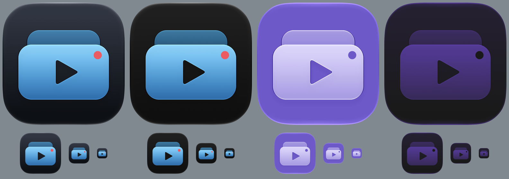

# Worked example: SlabVideo

A finished three-group icon for a Mac video app. Copy its structure, not its drawing.



`sheet.png` was made with `scripts/render-renditions.sh` and `scripts/contact-sheet.sh`:
Default, Dark, TintedLight and TintedDark on macOS, with 128, 64 and 32 px copies below.

## What each file shows

| File                                   | Shows                                                                                     |
| -------------------------------------- | ----------------------------------------------------------------------------------------- |
| `SlabVideo.icon/Assets/back.svg`       | A backdrop layer in its own group, with `opacity: 0.6` set on the layer in `icon.json`    |
| `SlabVideo.icon/Assets/foreground.svg` | A main shape with a `linearGradient` fill and an `evenodd` cut-out (the play triangle)    |
| `SlabVideo.icon/Assets/live.svg`       | A colored accent drawn as a plain `<circle>`                                              |
| `SlabVideo.icon/icon.json`             | Group order (top first), per-group glass settings, the accent's tinted override, the fill |

## Groups, top first

| Group      | Layer            | Settings worth copying                                                                                                         |
| ---------- | ---------------- | ------------------------------------------------------------------------------------------------------------------------------ |
| live       | `live.svg`       | Glass off, no specular, no shadow, no translucency, so the red stays red. Black fill in tinted mode, so it reads as a cut-out. |
| Foreground | `foreground.svg` | Default glass with a neutral shadow at 0.5, which falls on the back slab.                                                      |
| back       | `back.svg`       | Glass on, 60% opacity, more translucent than the front, so it sits behind.                                                     |

The tile is a graphite top-to-bottom gradient in the top-level `fill` key. The Dark
rendition comes out darker without an override.

## Rebuilding it from the SVGs

```bash
icon-composer create Assets/foreground.svg out --bundle-name SlabVideo \
  --glyph-scale 1.0 --no-split-layers --bg-color '#0D1015'
```

Then follow "Final bundle from per-layer SVGs" in `SKILL.md`: add `back.svg` and
`live.svg` each in a new group, reorder, set the glass per group, set the fill, and add
the tinted override on `live`.
